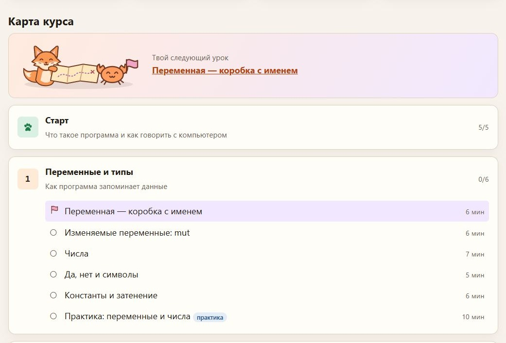
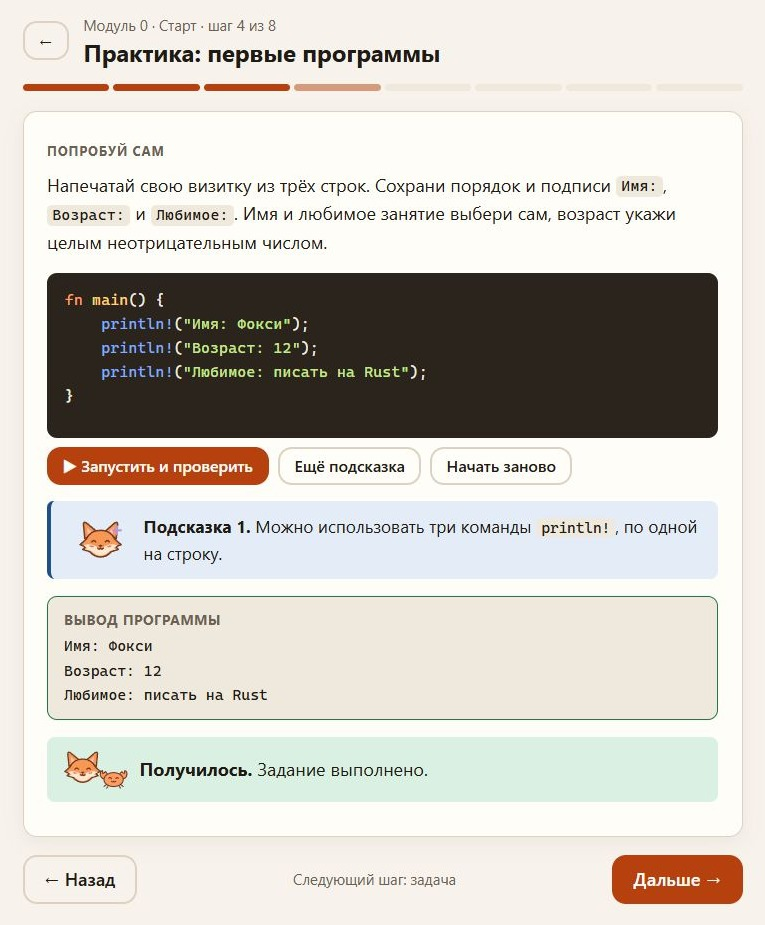
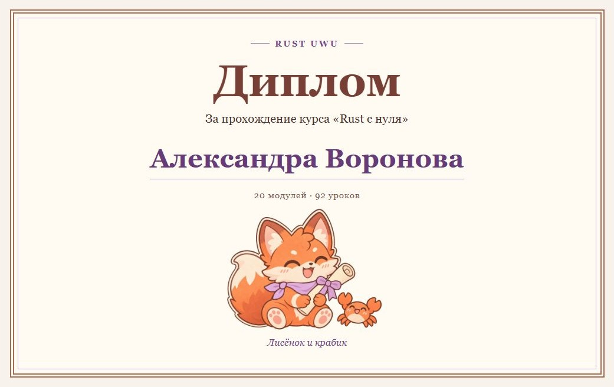
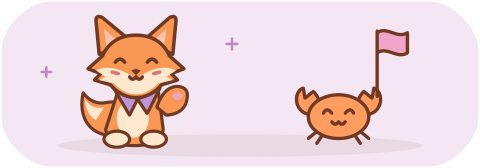

<p align="center">
  <a href="https://dinlemon.github.io/rust_uwu/">
    
  </a>
</p>

<h1 align="center">Rust UwU</h1>

<p align="center">
  <strong>Путь от первой строчки Rust до своего проекта. Лисёнок и крабик идут рядом.</strong>
</p>

<p align="center">
  <a href="#что-внутри"></a>
  <a href="#english"></a>
  <a href="LICENSE"></a>
</p>

<p align="center">
  <a href="https://dinlemon.github.io/rust_uwu/#/base"><strong>Начать учиться →</strong></a>
  &nbsp;·&nbsp;
  <a href="#что-внутри">Что внутри</a>
  &nbsp;·&nbsp;
  <a href="#как-выглядит-курс">Как выглядит курс</a>
  &nbsp;·&nbsp;
  <a href="#лисёнок-и-крабик">Лисёнок и крабик</a>
  &nbsp;·&nbsp;
  <a href="#english">English</a>
</p>

<p align="center">
  3 уровня &nbsp;·&nbsp; 48 модулей &nbsp;·&nbsp; 232 урока &nbsp;·&nbsp; RU / EN
</p>

## Что внутри

**Rust UwU** — интерактивный курс на русском и английском. Начни с первой программы, продолжи продвинутыми темами и дойди до мастерской со своими механизмами Rust. В трёх уровнях — 287 задач с проверкой и 13 домашних заданий на каждом языке.

### Base · Основы

[Открыть основы →](https://dinlemon.github.io/rust_uwu/#/base)

20 модулей, 92 урока, 116 задач. Первая программа, типы, владение, заимствование, коллекции, ошибки и Cargo. Итоговый проект — список дел на Rust.

### Pro · Продвинутый

<p align="center">
  <a href="https://dinlemon.github.io/rust_uwu/#/pro"></a>
</p>

[Открыть Pro →](https://dinlemon.github.io/rust_uwu/#/pro)

14 модулей, 68 уроков, 77 задач. Трейты и времена жизни глубже, итераторы, ошибки в больших программах, потоки, async, макросы, unsafe, FFI и инструменты измерения скорости. Итоговый проект — анализатор логов.

### Expert · Мастерская

<p align="center">
  <a href="https://dinlemon.github.io/rust_uwu/#/expert"></a>
</p>

[Открыть Expert →](https://dinlemon.github.io/rust_uwu/#/expert)

14 модулей, 72 урока, 94 задачи и 13 домашних заданий. Свой `Future` и исполнитель, аллокаторы, unsafe-коллекции, lock-free, `no_std`, CLI, базы данных, веб, WASM, тестирование свойств и собственный derive-макрос. Для домашних заданий нужен установленный Rust и Cargo. На сайте есть пункты самопроверки.

Уровни открыты сразу. Можно перейти к знакомой теме, а прогресс хранится отдельно для каждого уровня и общий для обоих языков.

<details>
<summary><strong>Посмотреть программу курса</strong></summary>

1. **Основы.** Знакомство с программированием, переменные, функции, владение, коллекции, трейты и тесты. Первый законченный проект.
2. **Продвинутый уровень.** Более подробное устройство типов, памяти и конкурентного кода. Библиотеки, инструменты и анализатор логов.
3. **Мастерская.** Реализация собственных механизмов, интеграция с вебом и базами данных, домашние проекты и проверки на своём компьютере.

</details>

## Как выглядит курс

### Карта твоего пути

Лисёнок разворачивает карту, крабик отмечает следующий урок. Пройденные модули получают отпечаток лапки.

<p align="center">
  <a href="assets/screenshot-map.jpg"></a>
</p>

### Практика с подсказками

Пиши код, запускай его на странице и открывай подсказки по одной. В визитке можно указать своё имя и любимое занятие.

<p align="center">
  <a href="assets/screenshot-practice.jpg"></a>
</p>

### Диплом на память

После завершения каждого уровня лисёнок и крабик вручат отдельный именной диплом. Введи имя, распечатай его или сохрани в PDF через окно печати. Ниже — образец диплома за основы.

<p align="center">
  <a href="assets/screenshot-diploma.jpg"></a>
</p>

<p align="center"><em>На скриншотах показаны демонстрационный прогресс и пример имени.</em></p>

<p align="center">
  <picture>
    <source media="(prefers-reduced-motion: reduce)" srcset="assets/readme-companions.svg">
    
  </picture>
</p>

<p align="center"><a href="https://dinlemon.github.io/rust_uwu/"><strong>Начать свой путь →</strong></a></p>

## Как проходят уроки

- **Одна карточка — одна мысль.** В начале урока есть план и примерное время. Таймеров нет, а дополнительные объяснения можно свернуть или пропустить.
- **Пиши и запускай код на странице.** В задачах есть автопроверка, подсказки по шагам, пропуски в коде и упражнения на порядок строк. В задачах с открытым ответом проверка принимает свои значения по формату задания. Для знакомых ошибок компилятора курс показывает простое объяснение рядом с оригиналом.
- **Возвращайся в своём темпе.** Повторение чаще предлагает вопросы, где была ошибка. Под рукой есть словарь и шпаргалка. Прогресс хранится в браузере, его можно выгрузить в файл и восстановить.
- **Настрой чтение под себя.** Есть светлая и тёмная темы, размер шрифта, фокус-режим и выключатель анимаций. План урока, простой буквальный язык и явно подписанные аналогии помогают сделать курс предсказуемым для людей с СДВГ и аутичных читателей.

> Компилятор сердится? Загляни в объяснение, поправь одну строчку и попробуй снова. UwU

## Лисёнок и крабик

На карте курса лисёнок разворачивает свиток, а крабик ставит флажок у следующего урока. У Pro и Expert свои иллюстрации и реакции по клику. В Pro маскоты собирают крейт и радуются пройденным тестам. В Expert проверяют механизм и встречают посетителя мастерской. Анимации можно выключить в настройках. Системное предпочтение уменьшенного движения тоже учитывается.

В практических заданиях лисёнок приносит подсказки, а после зачёта всех уроков уровня вместе с крабиком вручает именной диплом. Его можно открыть с главной этого уровня, распечатать на альбомном A4 или сохранить в PDF через окно печати.

## Как открыть

[Открыть курс в браузере →](https://dinlemon.github.io/rust_uwu/)

Можно также клонировать репозиторий и открыть `index.html` в браузере с включённым JavaScript. Сборка и локальная установка Rust для этого не нужны.

```sh
git clone https://github.com/DinLemon/rust_uwu.git
cd rust_uwu
```

Для кнопки «Запустить» нужен интернет. Код отправляется в [Rust Playground](https://play.rust-lang.org/) и выполняется в редакции Rust 2024. Если сервис недоступен, курс покажет ожидаемый вывод, когда он задан, и ссылку на Playground.

## English

**Rust UwU** is a bilingual interactive Rust course with three open levels. **[Base](https://dinlemon.github.io/rust_uwu/#/base)** covers the basics in 92 lessons, **[Pro](https://dinlemon.github.io/rust_uwu/#/pro)** goes deeper in 68 lessons, and **[Expert](https://dinlemon.github.io/rust_uwu/#/expert)** offers a 72-lesson workshop. In total, there are 48 modules, 232 lessons, 287 checked coding tasks and 13 home assignments per language. Expert home assignments require a local Rust and Cargo installation.

[Open the course](https://dinlemon.github.io/rust_uwu/#/base) and choose **EN** in the top bar. Run code in the browser, take hints one at a time, and come back whenever you like. Progress is tracked by level and shared across languages. Pro and Expert have their own fox-and-crab scenes with click reactions. Each completed level awards a printable diploma.

## Для авторов курса

<details>
<summary><strong>Исходники, сборка и формат уроков</strong></summary>

- [`course/ru/`](course/ru/) и [`course/en/`](course/en/) — исходники уроков и словарей. Порядок и типы карточек, ответы и число пропусков должны совпадать между языками. Так прогресс остаётся общим.
- [`tools/build.py`](tools/build.py) проверяет структуру и собирает по отдельному файлу для каждого уровня и языка в [`content/`](content/), а также [`content/manifest.js`](content/manifest.js) с версиями данных. Уроки `m*.txt` относятся к Base, `a*.txt` — к Pro, `x*.txt` — к Expert. Правки вноси в исходники уроков.
- [`tools/check_rust.py`](tools/check_rust.py) проверяет примеры и решения. Нужен `rustc` 1.85 или новее.
- [`docs/research.md`](docs/research.md) — заметки о методике, программе и устройстве курса.

После правок в уроках выполни из корня репозитория:

```sh
python3 tools/build.py
python3 tools/check_rust.py
```

При переводе можно временно собрать курс командой `python3 tools/build.py --partial`. Она подставит русские уроки вместо отсутствующих английских.

<details>
<summary>Шпаргалка по формату урока</summary>

````text
# MODULE m01 | Название модуля | Подзаголовок
## LESSON m01-1 | Название урока | 6          ← минуты
## LESSON m01-p | Практика | 10 | practice   ← урок-практика (метка на карте)

:: goals                       ← «В этом уроке»
- пункт

:: text Заголовок              ← обычный текст (Markdown: **жирный**, `код`, списки,
Текст.                           > совет, !> предупреждение, ```rust блоки)

:: code                        ← пример, который можно запустить и менять
Описание.
```rust
fn main() { println!("hi"); }
```
```out
hi
```
Текст после кода.
fails: yes                     ← пример специально не компилируется

:: quiz
Вопрос?
[x] верный ответ => почему верно
[ ] неверный => почему нет

:: fill                        ← пропуски ___ в коде
```rust
let ___ = 5;
```
= x | y                        ← допустимые ответы для пропуска

:: order                       ← собрать строки в правильном порядке
```rust
fn main() {
}
```

:: task                        ← задача с проверкой
Условие.
```rust
// заготовка
```
```solution
// решение
```
```expect
ожидаемый вывод
```
hint: подсказка 1
hint: подсказка 2
tests: yes                     ← запускать как тесты (cargo test)

:: deep Заголовок              ← необязательное углубление (свёрнуто по умолчанию)
Текст. Блок ```rust с fn main можно запускать.

:: recap                       ← «Запомни»
- пункт
````

</details>

Для задачи с произвольными значениями добавь блок `format` после `expect`. В шаблоне `{{text}}` означает непустой текст в одной строке, а `{{int}}` — целое неотрицательное число. Блок `expect` хранит пример вывода решения.

Одиночные числовые результаты можно печатать с подписью. Укажи `check: number`, если подпись есть в примере `expect` и тоже необязательна. Для заданий, где важен буквальный вывод и переносы строк, укажи `check: exact`.

</details>

## Лицензия

Тексты и код распространяются по лицензии [MIT](LICENSE).
