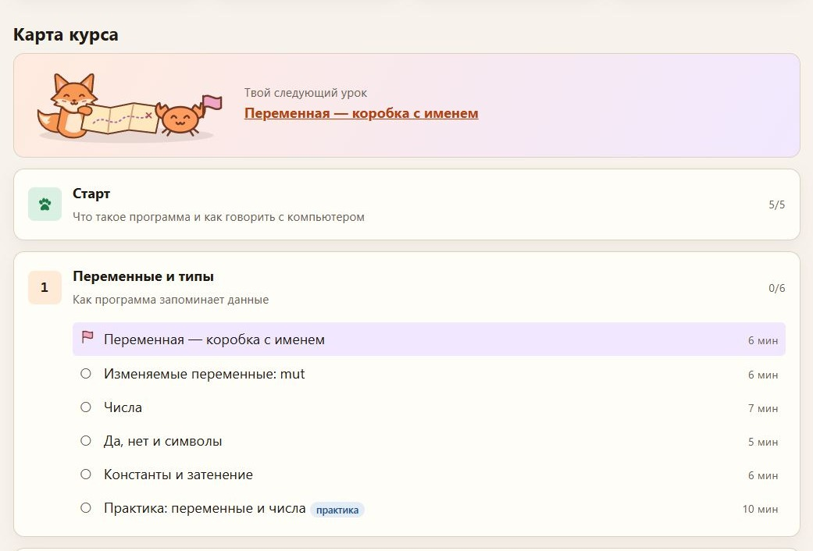
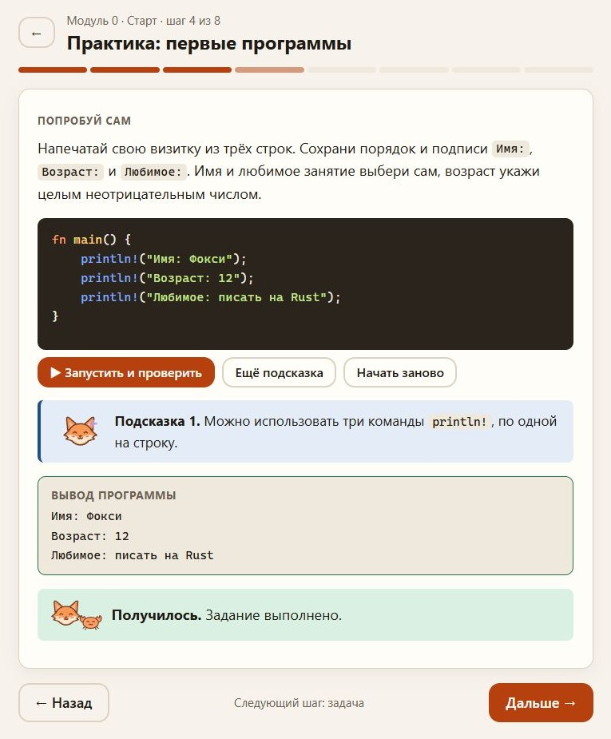
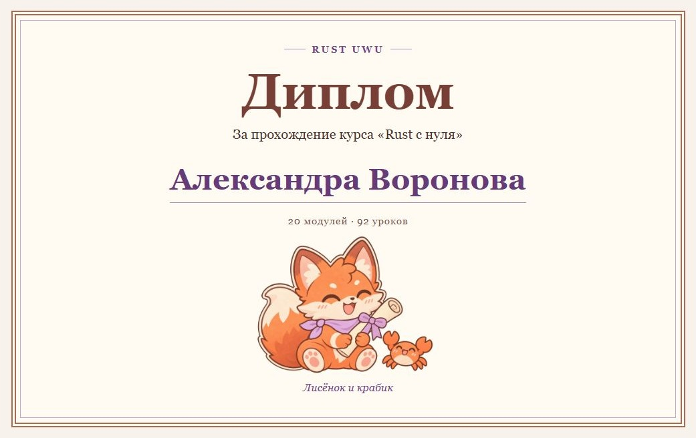
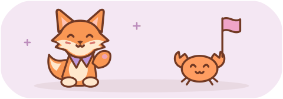

<p align="center">
  <a href="https://dinlemon.github.io/rust_uwu/">
    
  </a>
</p>

<h1 align="center">Rust UwU</h1>

<p align="center">
  <strong>Путь от первой строчки Rust до своего проекта. Лисёнок и крабик идут рядом.</strong>
</p>

<p align="center">
  <a href="#что-внутри"></a>
  <a href="#english"></a>
  <a href="LICENSE"></a>
</p>

<p align="center">
  <a href="https://dinlemon.github.io/rust_uwu/"><strong>Начать учиться →</strong></a>
  &nbsp;·&nbsp;
  <a href="#что-внутри">Что внутри</a>
  &nbsp;·&nbsp;
  <a href="#как-выглядит-курс">Как выглядит курс</a>
  &nbsp;·&nbsp;
  <a href="#лисёнок-и-крабик">Лисёнок и крабик</a>
  &nbsp;·&nbsp;
  <a href="#english">English</a>
</p>

<p align="center">
  20 модулей &nbsp;·&nbsp; 92 урока &nbsp;·&nbsp; 116 задач на каждом языке
</p>

## Что внутри

**Rust UwU** — интерактивный курс на русском и английском для тех, кто никогда не программировал. Сначала разберёмся, как компьютер выполняет команды, а в конце соберём свой список дел на Rust.

<details>
<summary><strong>Посмотреть программу курса</strong></summary>

1. **Первые шаги.** Знакомство с программированием, переменные, типы, функции, условия, циклы и коллекции.
2. **Данные в Rust.** Владение, заимствование, срезы, структуры, перечисления, `match` и обработка ошибок.
3. **Свой проект.** Модули, Cargo, обобщения, трейты, времена жизни, замыкания, итераторы и тесты.
4. **Темы посложнее.** Умные указатели, потоки, знакомство с `async` и макросами. В финале — приложение со списком дел.

</details>

## Как выглядит курс

### Карта твоего пути

Лисёнок разворачивает карту, крабик отмечает следующий урок. Пройденные модули получают отпечаток лапки.

<p align="center">
  <a href="assets/screenshot-map.jpg"></a>
</p>

### Практика с подсказками

Пиши код, запускай его на странице и открывай подсказки по одной. В визитке можно указать своё имя и любимое занятие.

<p align="center">
  <a href="assets/screenshot-practice.jpg"></a>
</p>

### Диплом на память

После всех 92 уроков лисёнок и крабик вручат именной диплом. Введи имя, распечатай его или сохрани в PDF через окно печати.

<p align="center">
  <a href="assets/screenshot-diploma.jpg"></a>
</p>

<p align="center"><em>На скриншотах показаны демонстрационный прогресс и пример имени.</em></p>

<p align="center">
  <picture>
    <source media="(prefers-reduced-motion: reduce)" srcset="assets/readme-companions.svg">
    
  </picture>
</p>

<p align="center"><a href="https://dinlemon.github.io/rust_uwu/"><strong>Начать свой путь →</strong></a></p>

## Как проходят уроки

- **Одна карточка — одна мысль.** В начале урока есть план и примерное время. Таймеров нет, а дополнительные объяснения можно свернуть или пропустить.
- **Пиши и запускай код на странице.** В задачах есть автопроверка, подсказки по шагам, пропуски в коде и упражнения на порядок строк. В задачах с открытым ответом проверка принимает свои значения по формату задания. Для знакомых ошибок компилятора курс показывает простое объяснение рядом с оригиналом.
- **Возвращайся в своём темпе.** Повторение чаще предлагает вопросы, где была ошибка. Под рукой есть словарь и шпаргалка. Прогресс хранится в браузере, его можно выгрузить в файл и восстановить.
- **Настрой чтение под себя.** Есть светлая и тёмная темы, размер шрифта, фокус-режим и выключатель анимаций. План урока, простой буквальный язык и явно подписанные аналогии помогают сделать курс предсказуемым для людей с СДВГ и аутичных читателей.

> Компилятор сердится? Загляни в объяснение, поправь одну строчку и попробуй снова. UwU

## Лисёнок и крабик

На карте курса лисёнок разворачивает свиток, а крабик ставит флажок у следующего урока. В практических заданиях лисёнок приносит подсказки, а после зачёта всех уроков вместе с крабиком вручает именной диплом. Его можно открыть с главной, распечатать на альбомном A4 или сохранить в PDF через окно печати.

## Как открыть

[Открыть курс в браузере →](https://dinlemon.github.io/rust_uwu/)

Можно также клонировать репозиторий и открыть `index.html` в браузере с включённым JavaScript. Сборка и локальная установка Rust для этого не нужны.

```sh
git clone https://github.com/DinLemon/rust_uwu.git
cd rust_uwu
```

Для кнопки «Запустить» нужен интернет. Код отправляется в [Rust Playground](https://play.rust-lang.org/) и выполняется в редакции Rust 2024. Если сервис недоступен, курс покажет ожидаемый вывод, когда он задан, и ссылку на Playground.

## English

**Rust UwU** is an interactive course for first-time programmers. It takes you from your first line of code to a small to-do app in Rust. The course has 20 modules and 92 lessons, with 116 auto-checked tasks in each language.

[Open the course](https://dinlemon.github.io/rust_uwu/) and choose **EN** in the top bar. Run code in the browser, take hints one at a time, and come back whenever you like. The browser saves your progress. The fox and crab mark your next lesson on the course map and award a printable diploma when you finish.

## Для авторов курса

<details>
<summary><strong>Исходники, сборка и формат уроков</strong></summary>

- [`course/ru/`](course/ru/) и [`course/en/`](course/en/) — исходники уроков и словарей. Порядок и типы карточек, ответы и число пропусков должны совпадать между языками. Так прогресс остаётся общим.
- [`tools/build.py`](tools/build.py) проверяет структуру и пересобирает [`content/course-data.js`](content/course-data.js). Правки вноси в исходники уроков.
- [`tools/check_rust.py`](tools/check_rust.py) проверяет примеры и решения. Нужен `rustc` 1.85 или новее.
- [`docs/research.md`](docs/research.md) — заметки о методике, программе и устройстве курса.

После правок в уроках выполни из корня репозитория:

```sh
python3 tools/build.py
python3 tools/check_rust.py
```

При переводе можно временно собрать курс командой `python3 tools/build.py --partial`. Она подставит русские уроки вместо отсутствующих английских.

<details>
<summary>Шпаргалка по формату урока</summary>

````text
# MODULE m01 | Название модуля | Подзаголовок
## LESSON m01-1 | Название урока | 6          ← минуты
## LESSON m01-p | Практика | 10 | practice   ← урок-практика (метка на карте)

:: goals                       ← «В этом уроке»
- пункт

:: text Заголовок              ← обычный текст (Markdown: **жирный**, `код`, списки,
Текст.                           > совет, !> предупреждение, ```rust блоки)

:: code                        ← пример, который можно запустить и менять
Описание.
```rust
fn main() { println!("hi"); }
```
```out
hi
```
Текст после кода.
fails: yes                     ← пример специально не компилируется

:: quiz
Вопрос?
[x] верный ответ => почему верно
[ ] неверный => почему нет

:: fill                        ← пропуски ___ в коде
```rust
let ___ = 5;
```
= x | y                        ← допустимые ответы для пропуска

:: order                       ← собрать строки в правильном порядке
```rust
fn main() {
}
```

:: task                        ← задача с проверкой
Условие.
```rust
// заготовка
```
```solution
// решение
```
```expect
ожидаемый вывод
```
hint: подсказка 1
hint: подсказка 2
tests: yes                     ← запускать как тесты (cargo test)

:: deep Заголовок              ← необязательное углубление (свёрнуто по умолчанию)
Текст. Блок ```rust с fn main можно запускать.

:: recap                       ← «Запомни»
- пункт
````

</details>

Для задачи с произвольными значениями добавь блок `format` после `expect`. В шаблоне `{{text}}` означает непустой текст в одной строке, а `{{int}}` — целое неотрицательное число. Блок `expect` хранит пример вывода решения.

Одиночные числовые результаты можно печатать с подписью. Укажи `check: number`, если подпись есть в примере `expect` и тоже необязательна. Для заданий, где важен буквальный вывод и переносы строк, укажи `check: exact`.

</details>

## Лицензия

Тексты и код распространяются по лицензии [MIT](LICENSE).
